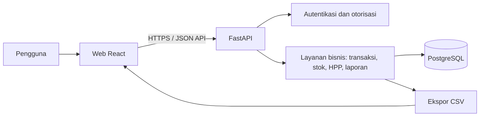

# Tahap 1 — Analisis Kebutuhan dan Arsitektur

## Tujuan MVP

Membuat aplikasi web pembukuan dan kalkulator HPP untuk satu usaha, dengan alur yang mudah dipahami pemilik UMKM. MVP mencatat produk, penjualan, pengeluaran, persediaan, dan komponen biaya produksi; kemudian menggunakan data tersebut untuk menghitung ringkasan usaha dan laporan sederhana.

Dokumen ini menetapkan batas dan rancangan awal. Implementasi dimulai bertahap setelah rancangan ini, bukan dengan membangun seluruh fitur sekaligus.

## Pengguna dan kebutuhan utama

Pengguna utama adalah pemilik atau staf usaha kecil yang mencatat transaksi harian tanpa latar belakang akuntansi. Antarmuka menggunakan Bahasa Indonesia, format rupiah dan tanggal Indonesia, istilah sederhana, petunjuk untuk istilah HPP, serta arahan yang jelas saat data masih kosong atau tidak valid.

Kebutuhan MVP:

1. Pengguna dapat mendaftar, masuk, dan hanya mengakses data usahanya sendiri.
2. Pengguna dapat mengelola produk, harga, HPP, stok, satuan, dan batas stok minimum.
3. Pengguna dapat mencatat penjualan yang berisi satu atau lebih produk. Sistem menyimpan harga dan HPP saat transaksi, mengurangi stok, serta menghitung omzet dan laba kotor.
4. Pengguna dapat mencatat pengeluaran usaha dan melihat dampaknya pada laporan.
5. Pengguna dapat merinci bahan, tenaga kerja, dan overhead untuk menghitung HPP produksi per unit.
6. Pengguna dapat menghitung harga jual dari target margin dan mensimulasikan hasil penjualan.
7. Pengguna dapat melihat ringkasan, tren, kondisi stok, laporan laba rugi sederhana, serta mengekspor data.

## Batas MVP dan asumsi

- Satu akun memiliki satu usaha pada versi pertama. Struktur data tetap menggunakan `business_id` agar pemisahan data dan pengembangan multi-usaha di masa depan lebih mudah.
- Pembukuan menggunakan basis kas sederhana. Laporan laba rugi MVP menghitung pendapatan penjualan dan pendapatan lain, dikurangi HPP barang terjual dan pengeluaran operasional yang dicatat. Pajak, depresiasi akuntansi, hutang/piutang, dan jurnal berpasangan belum termasuk.
- Penjualan mengurangi stok. Pengeluaran biasa tidak otomatis menambah stok. Pembelian stok dan penerimaan bahan memerlukan alur pembelian tersendiri yang dapat ditambahkan sesudah MVP; biaya bahan kalkulator HPP dicatat sebagai komponen resep/biaya, bukan penerimaan persediaan.
- Transaksi yang sudah tersimpan menggunakan snapshot nama produk, harga jual, dan HPP agar perubahan produk berikutnya tidak mengubah laporan historis.
- Pembatalan atau penghapusan transaksi harus membalik dampak stok dan nilai laporan secara konsisten. Riwayat perubahan transaksi disarankan; kebijakan edit transaksi yang sudah lama perlu ditentukan sebelum modul transaksi dibangun.
- Ekspor MVP dimulai dari CSV. Excel dan PDF dapat ditambahkan setelah format laporan disepakati.
- Grafik dan kartu dashboard dihitung dari transaksi tersimpan dengan filter tanggal; tidak memakai angka contoh statis.

## Arsitektur yang disarankan

Gunakan **monolit modular**: satu backend dan satu aplikasi web, dengan batas modul yang jelas. Bentuk ini menjaga validasi transaksi dan HPP di sisi server, memudahkan konsistensi database, dan menghindari kompleksitas layanan terdistribusi untuk MVP.

| Bagian | Pilihan awal | Tanggung jawab |
|---|---|---|
| Frontend | React, TypeScript, Vite | Halaman responsif, formulir, tabel, grafik, format tampilan |
| Backend | Python, FastAPI | API, autentikasi, validasi, aturan bisnis, laporan, ekspor |
| Database | PostgreSQL | Data pengguna, usaha, produk, transaksi, biaya, dan stok |
| Akses data | SQLAlchemy + Alembic | Pemetaan model dan migrasi skema |
| Grafik | Recharts | Grafik dashboard dan laporan |
| Pengembangan lokal | Docker Compose | Menjalankan frontend, backend, dan database secara konsisten |

Pilihan ini merupakan baseline proyek kosong. Sebelum Tahap 2, versi runtime dan dependensi perlu dipatok dan ditinjau bersama struktur implementasi aktual.

### Diagram komponen



### Alur transaksi penjualan

1. Frontend mengirim tanggal, metode pembayaran, catatan, dan minimal satu item.
2. Backend memeriksa sesi pengguna, kepemilikan usaha dan produk, jumlah positif, diskon, serta kecukupan stok.
3. Dalam satu transaksi database, backend mengambil harga dan HPP produk terkini, menghitung subtotal dan total, menyimpan header serta item snapshot, dan mencatat perubahan stok.
4. Jika salah satu langkah gagal, seluruh perubahan dibatalkan. Dashboard dan laporan membaca transaksi yang sudah tersimpan.

## Modul dan tanggung jawab

- **Akun dan usaha:** pendaftaran, masuk/keluar, profil usaha, kepemilikan dan pemisahan data.
- **Produk dan persediaan:** CRUD produk, kategori/satuan, harga, HPP aktif, stok, batas minimum, serta penyesuaian stok yang tercatat.
- **Transaksi:** penjualan dan pengeluaran MVP; nomor transaksi; metode pembayaran; item; validasi; snapshot; pembatalan yang membalik efek terkait.
- **Kalkulator HPP:** bahan, tenaga kerja, overhead, jumlah hasil produksi, biaya total dan biaya per unit.
- **Harga jual dan simulasi:** margin target, pilihan pembulatan, omzet, biaya, laba kotor, dan margin aktual.
- **Dashboard dan laporan:** agregasi berdasarkan rentang tanggal dari sumber transaksi yang sama.
- **Ekspor:** CSV dengan rentang periode dan kolom yang sesuai laporan.

## Aturan hitung yang harus konsisten

- Subtotal item = kuantitas × harga satuan.
- Total penjualan = jumlah subtotal − diskon; total tidak boleh negatif.
- HPP terjual = jumlah kuantitas × snapshot HPP per unit.
- Laba kotor = total penjualan − HPP terjual.
- HPP batch = biaya bahan terpakai + tenaga kerja + overhead batch.
- HPP per unit = HPP batch ÷ jumlah hasil produksi; jumlah hasil harus lebih dari nol.
- Jika harga beli bahan berlaku untuk kuantitas tertentu, biaya pemakaian = (harga beli ÷ kuantitas beli) × kuantitas yang digunakan. Satuan harus dikonversi ke satuan dasar yang kompatibel sebelum hitung.
- Untuk tenaga kerja, biaya per unit = biaya tenaga kerja batch ÷ jumlah produk yang dihasilkan.
- Harga jual berdasarkan margin = HPP ÷ (1 − margin). Margin harus 0% sampai kurang dari 100%; nilai 100% tidak memiliki harga jual terbatas.
- Pembulatan harga dilakukan setelah harga rekomendasi dihitung. Simulasi menampilkan omzet, total HPP, laba kotor, dan laba setelah biaya operasional bila datanya tersedia.
- Nilai uang disimpan sebagai bilangan desimal dengan presisi tetap, bukan floating point biner. Aturan pembulatan rupiah ditentukan dan diuji pada tahap implementasi perhitungan.

## Data inti untuk rancangan skema berikutnya

Entitas utama: `users`, `businesses`, `categories`, `units`, `products`, `materials`, `product_recipes`/`product_materials`, `labor_costs`, `overhead_costs`, `transactions`, `transaction_items`, `expenses`, dan `stock_movements`.

Semua data milik usaha membawa `business_id` secara langsung atau dapat ditelusuri melalui relasi. Item transaksi menyimpan snapshot produk, kuantitas, harga, diskon yang dialokasikan bila digunakan, dan HPP per unit. Perubahan stok dicatat sebagai pergerakan bertanggal dan berkaitan dengan transaksi atau penyesuaian. Skema final, kunci asing, indeks, aturan hapus, dan ERD menjadi keluaran Tahap 2.

## Keamanan dan mutu data

- Seluruh endpoint data memeriksa autentikasi dan memastikan setiap record berada dalam usaha milik pengguna aktif.
- Password disimpan sebagai hash kuat dari pustaka autentikasi teruji; tidak pernah disimpan atau dicatat sebagai teks biasa.
- Validasi harga dan biaya nonnegatif, kuantitas positif, margin di bawah 100%, item transaksi minimal satu, serta stok tidak negatif dilakukan di backend.
- Perubahan transaksi dan stok memakai transaksi database agar tidak ada stok atau laporan setengah terbarui.
- Rahasia aplikasi disimpan melalui environment, tidak di-commit. Database produksi perlu backup terjadwal dan koneksi terenkripsi.
- Pesan kesalahan untuk pengguna menggunakan Bahasa Indonesia dan tidak membeberkan detail internal.

## Struktur folder target

```text
.
├── docs/
│   └── 01-analisis-arsitektur.md
├── frontend/
│   ├── src/
│   │   ├── app/
│   │   ├── components/
│   │   ├── features/
│   │   ├── lib/
│   │   └── styles/
│   └── package.json
├── backend/
│   ├── app/
│   │   ├── api/
│   │   ├── core/
│   │   ├── db/
│   │   ├── models/
│   │   ├── schemas/
│   │   ├── services/
│   │   └── modules/
│   ├── migrations/
│   └── pyproject.toml
├── compose.yaml
└── .env.example
```

Struktur ini target bertahap; folder implementasi akan dibuat saat tahap terkait dikerjakan.

## Urutan tahap kerja

1. **Analisis dan arsitektur:** selesai melalui dokumen ini.
2. **Skema database dan ERD:** definisikan relasi, constraint, indeks, dan migrasi awal.
3. **Autentikasi:** registrasi, login/logout, profil usaha, dan otorisasi data.
4. **Produk dan inventori:** CRUD, satuan, kategori, saldo awal, serta pergerakan stok.
5. **Transaksi:** penjualan dan pengeluaran yang atomik, snapshot, dan pembalikan stok.
6. **Kalkulator HPP:** resep bahan, tenaga kerja, overhead, konversi satuan, dan biaya per unit.
7. **Harga jual dan simulasi:** margin, pembulatan, dan proyeksi.
8. **Dashboard:** kartu dan grafik dari data transaksi.
9. **Laporan:** laba rugi sederhana, arus kas, laporan HPP, dan ekspor.
10. **Validasi akhir:** uji hitungan, akses lintas usaha, alur stok, ekspor, dan tampilan responsif.

## Pertanyaan keputusan sebelum tahap berikutnya

Rancangan awal mengasumsikan satu usaha per akun dan ekspor CSV untuk MVP. Jika kebutuhan berbeda, model akun/usaha dan cakupan ekspor perlu disesuaikan sebelum skema database Tahap 2 dibuat.
