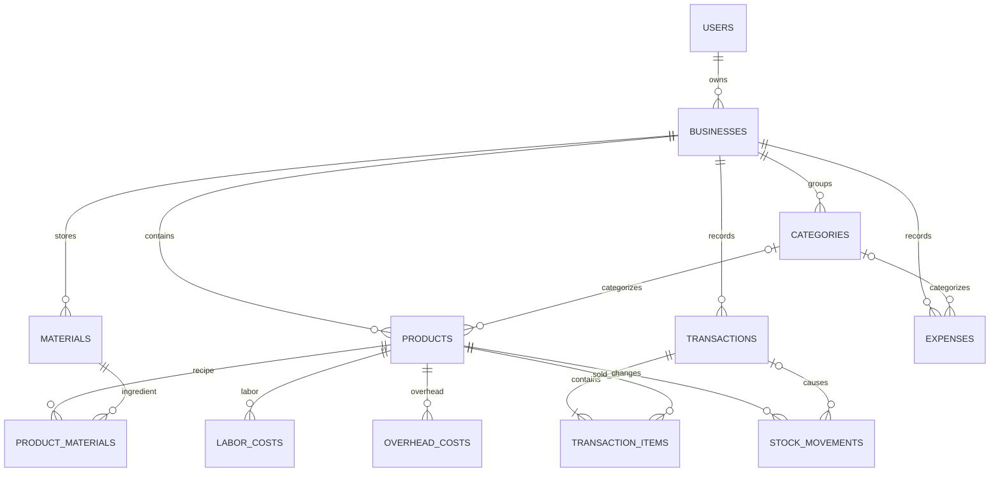

# Tahap 2 — Skema Database dan ERD

## Keputusan skema

Semua nominal menggunakan `NUMERIC(18,2)`. Kuantitas menggunakan presisi desimal agar bahan dapat dicatat dalam gram/ml, sementara jumlah unit produk jadi tetap dapat divalidasi sebagai positif. Record usaha memakai `business_id`; endpoint harus tetap memeriksa kepemilikan di setiap permintaan.

Penjualan dan pemasukan lain berada di `transactions`; pengeluaran berada di `expenses`. Penjualan memiliki baris `transaction_items` dan pergerakan stok. `stock_movements` menjadi jejak perubahan stok, sedangkan `products.stock` adalah saldo terkini untuk pemeriksaan cepat. Perubahan saldo dan ledger harus terjadi dalam transaksi database yang sama.

Skema SQL awal yang dapat dijalankan berurutan ada di [`backend/schema.sql`](../backend/schema.sql). Tabel inti beserta constraint disiapkan untuk migrasi tahap implementasi.

## ERD



## Relasi dan aturan penting

- Email pengguna unik; satu pengguna dapat memiliki satu atau lebih usaha secara struktur, walau alur MVP membuat satu usaha saat registrasi.
- Produk dan bahan tidak dihapus permanen setelah digunakan. Gunakan status aktif agar histori transaksi dan resep tetap dapat dibaca.
- Item penjualan menyimpan nama, SKU, harga jual, HPP per unit, kuantitas, dan subtotal snapshot. Laporan historis tidak bergantung pada nilai produk saat ini.
- HPP resep menyimpan kuantitas bahan yang digunakan per satu batch dan jumlah hasil batch. Biaya tenaga kerja/overhead menyimpan cakupan (`per_unit`, `per_batch`, atau `per_month`) serta jumlah; konversi bulanan ke produk memerlukan asumsi volume sehingga tidak otomatis sebelum parameter produksi tersedia.
- Stok awal dan penyesuaian juga menjadi baris `stock_movements`; transaksi penjualan menghasilkan kuantitas negatif. Constraint saldo nonnegatif tetap ditegakkan oleh service dalam transaksi database.
- Soft-delete transaksi belum diterapkan dalam SQL awal. Pembatalan transaksi harus memakai status `void` dan membalik pergerakan stok satu kali saja.

## Struktur folder setelah Tahap 2

```text
docs/
  01-analisis-arsitektur.md
  02-skema-database.md
backend/
  schema.sql
```

## Menjalankan skema

Skema ini ditulis untuk PostgreSQL. Setelah PostgreSQL tersedia, jalankan `psql "$DATABASE_URL" -f backend/schema.sql`. Implementasi tahap berikutnya akan mengemas perubahan skema sebagai migrasi agar dapat ditingkatkan dengan aman.
